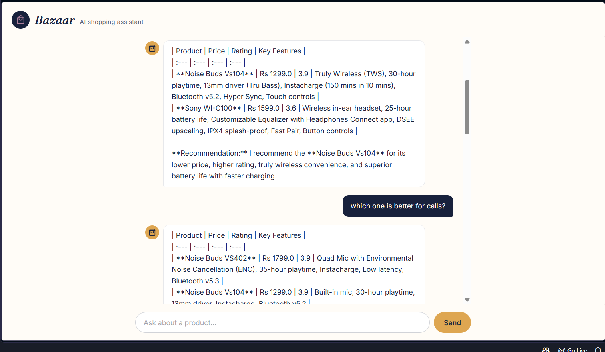
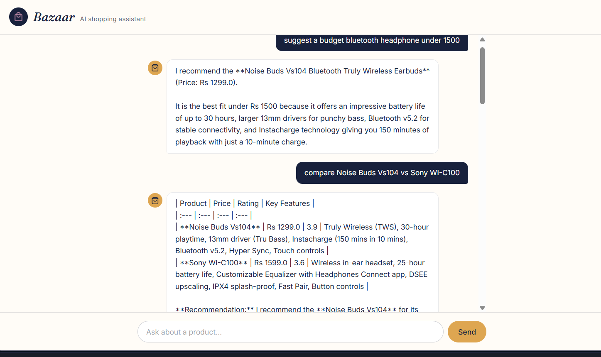

# AI-Shopping-Assistant
# Bazaar: AI Shopping Assistant (LLM + RAG)

Bazaar is a conversational shopping assistant. Users search for products in plain language, compare them, and read review summaries. Answers are generated by Gemini but grounded in a product catalog retrieved through semantic search (FAISS + sentence embeddings), so the assistant only talks about products that actually exist in the data.

## Screenshots

### Product Search & Recommendation


### Product Comparison

## Features

- **Semantic search.** Queries like "budget bluetooth headphone under 1500" match products by meaning, not exact keywords.
- **Product comparison.** Ask to compare products and get a table of price, rating and key features, plus a recommendation.
- **Review summarization.** A button on each product card turns its reviews into pros, cons and a verdict.
- **Conversation memory.** Follow-ups such as "which one is better for calls?" are rewritten into standalone queries using recent chat history, so retrieval stays accurate.
- **Grounded answers.** The prompt restricts the model to retrieved products. When nothing fits, it says the item isn't in the catalog instead of inventing one.
- **Persistent history.** Chats are stored per session in MongoDB and reload on refresh.

## Architecture

```
React (Vite + Tailwind)
        │  REST (axios)
        ▼
Express API (Node.js)  ──────►  MongoDB Atlas  (products, chat history)
        │  REST (axios)
        ▼
Python RAG service (FastAPI)
   ├─ HuggingFace sentence-transformer embeddings
   ├─ FAISS vector index (semantic search)
   ├─ LangChain (prompts, conversation memory)
   └─ Google Gemini API (answer generation)
```

**Why two backend services?** Python has the strongest ecosystem for AI work (LangChain, FAISS, HuggingFace), so the RAG pipeline lives there. Express handles application logic such as sessions and chat history, and is the single gateway the frontend talks to. Either side can change (a different LLM, added authentication) without touching the other.

## Tech Stack

| Layer | Technology |
|---|---|
| Frontend | React (Vite), Tailwind CSS, Axios |
| Backend API | Node.js, Express |
| AI service | Python, FastAPI |
| Database | MongoDB Atlas |
| Vector search | FAISS |
| Embeddings | `sentence-transformers/all-MiniLM-L6-v2` |
| Orchestration | LangChain |
| LLM | Google Gemini API |

## Project Structure

```
ai-shopping-assistant/
├── client/            # React frontend (chat UI, product cards, review summaries)
├── server/            # Express API: /api/chat, /api/summarize, chat history
└── rag-service/       # Python RAG service
    ├── convert.py         # Cleans the raw CSV into product documents
    ├── load_to_mongo.py   # Loads products into MongoDB
    ├── ingest.py          # Builds the FAISS index from MongoDB
    ├── rag.py             # Retrieval, prompting and Gemini calls
    ├── main.py            # FastAPI app: /chat and /summarize
    └── Dockerfile         # Container definition for the RAG service
```

## How the RAG pipeline works

1. **Ingestion.** `convert.py` cleans an Amazon India product dataset (prices, ratings, categories, duplicates). `load_to_mongo.py` stores it in MongoDB. `ingest.py` turns each product (name, category, price, rating, description, specs, reviews) into one document, embeds it, and saves a FAISS index.
2. **Query handling.** An incoming question is first rewritten into a standalone query using the last few chat turns. The top 5 most similar products are then retrieved from FAISS.
3. **Generation.** The retrieved products are passed to Gemini with instructions to answer only from that context, compare in a table when asked, and say so when nothing matches.

## Setup

### Prerequisites

- Node.js 18+
- Python 3.10+
- A MongoDB Atlas cluster (the free tier works)
- A Google Gemini API key from [Google AI Studio](https://aistudio.google.com)

### 1. Clone

```bash
git clone https://github.com/Anshika404err/AI-Shopping-Assistant.git
cd AI-Shopping-Assistant
```

### 2. RAG service (Python)

```bash
cd rag-service
python -m venv venv
venv\Scripts\activate          # Windows
# source venv/bin/activate     # macOS / Linux

pip install -r requirements.txt
cp .env.example .env           # then add your MONGO_URI and GOOGLE_API_KEY
```

Place the dataset CSV in `rag-service/data/`, then build the data and the index:

```bash
python convert.py        # clean the CSV into products.json
python load_to_mongo.py  # load products into MongoDB
python ingest.py         # build the FAISS index
uvicorn main:app --reload --port 8000
```

### 3. Express API

```bash
cd server
npm install
cp .env.example .env     # add MONGO_URI and RAG_URL=http://127.0.0.1:8000
npm run dev
```

### 4. React frontend

```bash
cd client
npm install
npm run dev
```

Open `http://localhost:5173`.

## Example questions

- "Suggest a good budget bluetooth headphone under 1500 rupees"
- "Compare Noise Buds Vs104 vs Sony WI-C100"
- "Which one is better for calls?" (a follow-up that relies on memory)
- Click **Summarize reviews** on any product card

## Known limitations

- The catalog comes from a public Amazon India dataset and is mostly electronics and home appliances. Searches for other categories get an honest "not in the catalog" reply. Brand names are inferred from the product name where the raw data had no brand field.
- Reviews in the source data are stored as combined text per product, not one review per row.
- The Gemini free tier is rate limited, so heavy use can return temporary errors.
- The FAISS index is built offline and loaded into memory. After the catalog changes, run `ingest.py` again and restart the service.
- The project runs locally. The RAG service loads an embedding model that needs more memory than most free hosting tiers provide, so a Dockerfile is included for deployment on a larger instance.

## Possible improvements

- Metadata filters (price range, category) combined with semantic search
- Streaming responses
- A broader or live product catalog
- User accounts and saved wishlists
- Hosted deployment
